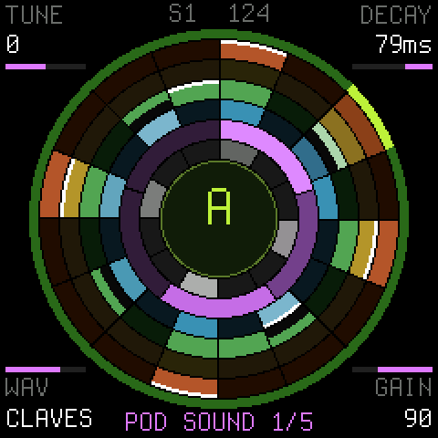

# KALK

**A beat composer for the M-VAVE FM-1**, after the workflow of Native Instruments' *Limelite* (Reaktor). Five
drum and tone voices, each with 16 synthesised variants and 8 CC0 samples, a three-lane main sequence in four patterns, a second window of lanes that loop on
their own lengths, 127 remix variations, an XY effect with recorded motion, a tempo-synced delay and a maximiser.

*Kalk* is lime, the stone. KALK is an independent work: no code, samples or artwork of
Limelite are in it. The sounds are synthesised, or CC0 recordings from Versilian Studios' VCSL.

<p align="center"></p>

**The screen is a lime slice.** Six rings, one a lane: KICK outside, then SNARE, HAT, TIE, POD, MOD. Each ring is cut
into as many wedges as its lane has steps, so a 5-step POD visibly turns against a 16-step kick. Lit wedges are steps,
a white edge an accent, a hollow wedge an open hat; the selected lane glows. The peel is the playhead's track, purple
while the remix plays. The pattern sits in the middle; the four knobs in the corners (K1 top left, K2 top right, K3
bottom left, K4 bottom right); the page, or a message, along the bottom.

> **Status: 0.2, untested on hardware.** Everything below runs and is tested on the host (the real firmware source,
> compiled for a computer: sound, screen, keys, MIDI). The first install on an FM-1 is the test that is still missing.
> Install at your own risk. The way back to the official firmware is always one install away (below).

## Install

1. Get the way back ready: M-VAVE's stock firmware (FM-1 V15, "PC Firmware" at m-vave.com) or the
   [FM-1 Firmware Hub](https://thefirmwarehub.com)'s *Return to official V15*.
2. Get `kalk.fwsc` from this repository's Actions run ("packages" artifact) or its Releases.
3. Connect the FM-1 by USB and install it with any FM-1 web installer that takes a file (the Hub's, Felucca's), or:
   `python3 tools/fm1_install.py kalk.fwsc`
4. If it does not start: hold **OCT-** while switching on (USB rescue), and install another firmware.

## The panel

```
 black keys   F#3 KICK  G#3 SNARE  A#3 HAT  |  C#4 TIE  D#4 POD  |  F#4 MOD  G#4 A  A#4 B  |  C#5 C  D#5 D  |  F#5 NOW
 white keys   the 16 steps of the selected lane
```

| | |
| --- | --- |
| **white key** | tap: step on / off. Hold (350 ms): accent. **SEL** + tap on HAT: open hat |
| **TIE / POD / MOD step** | hold it and turn **K1**: its value (TIE, POD: -12..+12 semitones; MOD: 1..15) |
| **lane key** | select the lane (stopped: you hear it). **OCT- / OCT+**: previous / next lane |
| **A B C D** | the pattern: playing, it changes at the end of the bar. Hold one and press another: copy |
| **NOW** (F#5) | the remix, while held |
| **PLAY** | start / stop. With MIDI clock (GLOBAL > SYNC MIDI): START / STOP from the clock, KALK follows its tempo and phase |
| **REC** | XFX page: record the pad's motion (X / Y) over 4 bars. SEL + REC: forget it. Holding a lane key: clear that lane. REMIX page: NOW on / off |
| **HOME / EDIT** | the selected lane's sound (again: next page) |
| **FX, SEQ, ARP, GLO** | effects, sequence, remix, global (again: next page) |
| **SELECT** | the page. **K1-K4**: the four values on the screen. **ALGORITHM**: tempo. **PRESETS**: the project slot (1-8) |
| **SAVE** | save the project to the slot (stopped). **SEL + SAVE**: load it |
| **ENV / LFO** | mute / solo the selected lane |

## The voices

All five have TUNE, DECAY, WAV (SYN 1..16: synthesised; then 8 samples by name), GAIN, CUT, RES, FILT (LP / BP / HP), PAN, ACC (how much softer an
unaccented hit is), MOD> and MOD (where the mod lane goes: WAV, PITCH, DECAY or CUT, and how much), and four of their own:

| | X1 | X2 | X3 | X4 | START |
| --- | --- | --- | --- | --- | --- |
| **KICK** | SAT | CLICK | SWEEP (the pitch drop's time) | HOLD | skips into the attack |
| **SNARE** | SAT | SNAPPY | FLAM | HOLD | softens the body |
| **HAT** (DECAY: closed) | OP DEC (open) | LINK: closed and open choke each other | NOISE | HOLD | |
| **TIE** (FM tone) | FM | RATIO (the modulator) | PORT (glide) | ATTACK | NOISE |
| **POD** (a struck tone) | ZAP | ZAPDEC | NOISE | HOLD | |

### The samples (WAV 17..24)

| | |
| --- | --- |
| KICK | CAJON, FRAME, FRAME-M, BDRUM, CONCERT, TUMBA, LOW TOM, LOG LO |
| SNARE | SNARE, SN OFF, RIMSHOT, X-STICK, ROPE, CLAPS, CLAP, SLAP |
| HAT (closed / open) | HIHAT, HH SOFT, PEDAL, SHAKER, TAMB, CABASA, SLEIGH, CYMBAL |
| TIE (pitched by its steps, glides) | LOG HI, COWBELL, COWBL 2, AGOGO, WOOD, CONGA, BONGO, HI TOM |
| POD (ZAP bends them) | CLAVES, TRIANGL, BRAKE, QUINTO, VIBRSLP, BONGO L, AGOGO L, TRI MUT |

A sample plays through the voice's filter, SAT, pitch and envelope: DECAY holds it for half its time, then releases
(Limelite's hold and release); START skips into it. CC0 1.0, from [VCSL](https://github.com/sgossner/VCSL) by
Versilian Studios: `assets/samples-cc0/ATTRIBUTION.txt`. `tools/gen_samples.py` rebuilds the banks (8-bit mu-law, in
the app's flash).

## The sequence

- **Main**: KICK, SNARE, HAT in patterns A-D. SEQ > MAIN: LEN 1-16, START, SWING, HALF (half tempo).
- **Second window**: TIE, POD, MOD each loop on their own length (SEQ > LANES, or the lane's LANE page). STRTCH fits a
  lane to the main length: a lane of 3 plays 3 even steps across the bar.
- **Chain**: SEQ > CHAIN: 2-8 bars of A-D in any order (SLOT, PATT).
- **Remix** (ARP): REMIX 1-127 picks a variation of the main lanes (turned, backwards, half and double time, stutters,
  beats shuffled, holes, scattered); EVERY plays it every 8th / 4th / 2nd / every bar; SHIFT moves its start; LANES
  which of K S H it touches. NOW plays it while held.

## The effects

| Page | K1 | K2 | K3 | K4 |
| --- | --- | --- | --- | --- |
| XFX | the effect | X | Y | MOTION: OFF, PLAY, SMOOTH |
| DELAY | L (16ths) | R (16ths) | FDBK | SEND |
| DELAY 2 | DAMP | WIDTH (ping-pong) | XMIX (XFX dry / wet) | MOD>FX: the mod lane GATEs XFX, sets its MIX or its X |
| FILTER | CUT | RES | MOD (the mod lane) | TRK (follows the level) |
| EQ | LO | MID | HI | AMP |
| OUT | GAIN | PITCH (+-12, all voices) | DIRT | NORM (the maximiser) |

XFX: THRU, CRUSH (bits, rate), BPF, RING (frequency, wobble), COMB (time, feedback), REPEAT (length; Y over the middle
repeats), LPF, HPF, FOLD (drive, bias), GATE and PAN (rate, depth, tempo synced), FLANGE (rate, depth).

## MIDI

In (USB and the TRS jack), on CHAN (OMNI or 1-16): 36 kick, 38 / 40 snare, 42 / 44 closed hat, 46 open hat, 39 pod,
48-72 tie (60 = its pitch); velocity 100 and up is an accent. Clock, START, CONTINUE, STOP with SYNC MIDI. Out (OUT ON):
every hit as a note on channel 10 (or CHAN).

## Build

Linux x86-64 (macOS / Windows: Docker or WSL), Python 3 with Pillow, the JieLi toolchain and three files of the AC79
SDK, as for every FM-1 firmware of this family:

```sh
tools/get_toolchain.sh
git clone --depth 1 --branch AC79NN_SDK_V1.2.1_2023-12-13 https://gitee.com/Jieli-Tech/fw-AC79_AIoT_SDK.git ~/fw-AC79_AIoT_SDK
./build.sh                       # -> build/kalk.fwsc (identity FM-1_960)
./build.sh --release 0.1         # -> build/kalk-0.1.fwsc (FM-1_961)
```

Or push to GitHub: `.github/workflows/release.yml` builds it with the Firmware Hub's attested workflow
([zvenson/fm1-build](https://github.com/zvenson/fm1-build)).

Without the toolchain, on any computer with a C compiler:

```sh
sh tests/run_host_tests.sh       # the voices, the demo, MIDI, the panel: build/host/*.wav and screens
sh tests/run_host.sh tests/scripts/showcase.txt   # a minute of KALK -> build/host/kalk.wav
python3 tools/gen_tables.py      # after changing a table's range
```

The source: `firmware/src/kalk.c` (the panel, the screen, the project), `kalk_voice.c`, `kalk_seq.c`, `kalk_fx.c`,
`kalk_dsp.h`, `kalk_model.h`. What the platform gives: [docs/API.md](docs/API.md); the chip's rules:
[docs/RULES.md](docs/RULES.md). The GLOBAL page shows the audio render's CPU share on the device.

## Credits

Built on [Dinghy](https://github.com/zvenson/dinghy) (zvenson), on the platform of
[Felucca](https://github.com/hugelton/Felucca) (Leo Kuroshita, Hügelton Instruments) and
[SLOOP](https://github.com/isod89/sloop-fm1) (isod89). GPL-3.0-only; who made what: [LICENSING.md](LICENSING.md).
